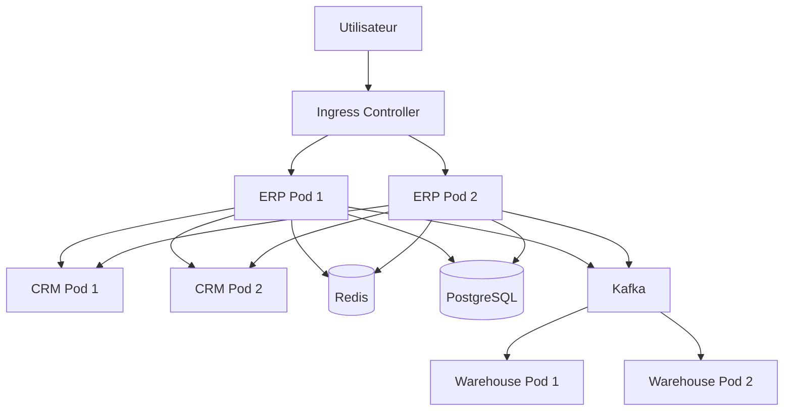
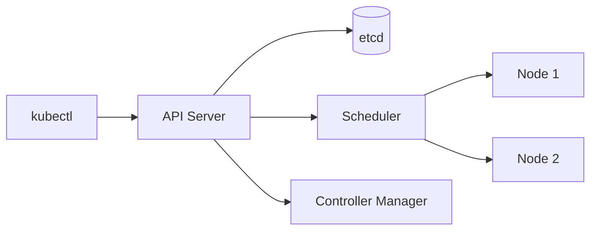
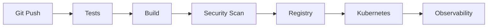
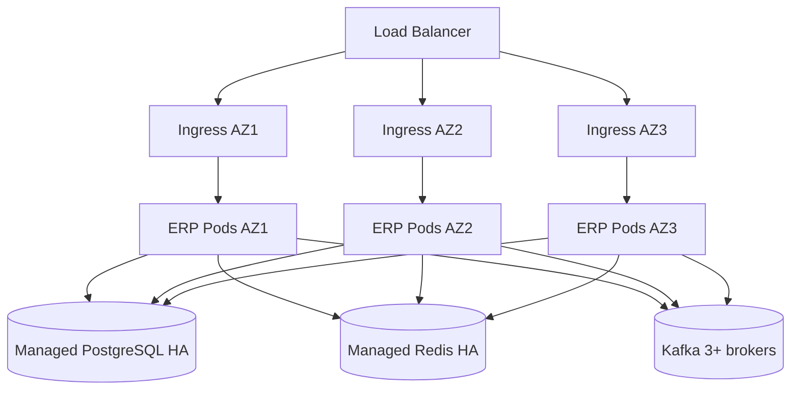

# TP 5 - Kubernetes, haute disponibilité et mise en production cloud-native


## Deployments, Services, Ingress, ConfigMaps, Secrets, probes, HPA, rolling update, canary, autoscaling, observabilité et résilience

**Niveau :** architecture production  
**Durée conseillée :** 2 h à 3 h  
**Architecture :** microservices distribués sur Kubernetes  
**Technologies :** Docker, Kubernetes, kubectl, Kind ou Minikube, FastAPI, PostgreSQL, Redis, Kafka, Nginx Ingress, Prometheus, Grafana  
**Systèmes :** Linux, macOS, Windows PowerShell

---

# 1. Objectifs du TP

À la fin de ce TP, vous serez capable de :

- comprendre l'architecture générale de Kubernetes ;
- créer et administrer un cluster local ;
- déployer plusieurs microservices ;
- comprendre Pods, ReplicaSets, Deployments et Services ;
- exposer des applications en interne et en externe ;
- utiliser un Ingress ;
- utiliser ConfigMaps et Secrets ;
- comprendre les probes Kubernetes ;
- distinguer liveness, readiness et startup probes ;
- configurer requests et limits CPU/RAM ;
- mettre en place un Horizontal Pod Autoscaler ;
- effectuer un rolling update ;
- effectuer un rollback ;
- comprendre une stratégie canary ;
- analyser la haute disponibilité ;
- simuler la destruction d'un pod ;
- observer l'auto-réparation Kubernetes ;
- comprendre les StatefulSets ;
- comprendre les PersistentVolumes et PersistentVolumeClaims ;
- déployer Redis et PostgreSQL ;
- gérer la configuration entre environnements ;
- utiliser les namespaces ;
- comprendre les NetworkPolicies ;
- observer les logs et événements ;
- diagnostiquer des CrashLoopBackOff ;
- analyser les OOMKilled ;
- tester la résilience d'une architecture ;
- déployer une architecture ERP / CRM / Warehouse ;
- introduire Prometheus et Grafana ;
- comprendre les bases du GitOps et du CI/CD Kubernetes.

---

# 2. Architecture cible

Nous reprenons l'architecture distribuée des TP précédents et nous la déployons sur Kubernetes.



---

# 3. Pourquoi Kubernetes ?

Docker Compose est très pratique pour :

```text
développement local
tests
petites architectures
```

Mais il ne fournit pas nativement, au même niveau :

```text
auto-healing
autoscaling
rolling updates
service discovery avancée
orchestration multi-nodes
scheduling
gestion déclarative
```

Kubernetes ajoute cette couche d'orchestration.

---

# 4. Architecture interne de Kubernetes



---

# 5. Control Plane

Le Control Plane contient notamment :

```text
API Server
Scheduler
Controller Manager
etcd
```

---

# 6. API Server

Toutes les opérations passent par l'API Kubernetes.

Exemple :

```bash
kubectl get pods
```

`kubectl` parle à l'API Server.

---

# 7. etcd

`etcd` stocke l'état du cluster.

Exemple :

```text
Deployments
Services
ConfigMaps
Secrets
état désiré
```

---

# 8. Scheduler

Le Scheduler décide :

```text
sur quel node placer un Pod
```

selon :

```text
CPU
RAM
contraintes
affinités
taints
tolerations
```

---

# 9. Controller Manager

Il vérifie continuellement :

```text
état réel
vs
état désiré
```

Exemple :

```text
replicas souhaitées = 3
replicas réelles = 2
```

Le contrôleur crée un nouveau Pod.

---

# 10. Préparer l'environnement

Deux options recommandées :

```text
Kind
Minikube
```

---

# 11. Vérifier Docker

```bash
docker --version
```

---

# 12. Vérifier kubectl

```bash
kubectl version --client
```

---

# 13. Installer Kind

## Linux / macOS

```bash
curl -Lo ./kind \
  https://kind.sigs.k8s.io/dl/latest/kind-linux-amd64

chmod +x ./kind

sudo mv ./kind /usr/local/bin/kind
```

## Windows

Avec Chocolatey :

```powershell
choco install kind
```

ou via Scoop :

```powershell
scoop install kind
```

---

# 14. Créer un cluster Kind

Créer :

```text
kind-config.yaml
```

```yaml
kind: Cluster
apiVersion: kind.x-k8s.io/v1alpha4

nodes:

  # Node de contrôle.
  - role: control-plane

    # Mapping pour exposer l'Ingress localement.
    extraPortMappings:
      - containerPort: 80
        hostPort: 8080
        protocol: TCP

  # Deux workers afin de simuler un petit cluster multi-node.
  - role: worker

  - role: worker
```

---

# 15. Créer le cluster

```bash
kind create cluster \
  --name tp5-cluster \
  --config kind-config.yaml
```

---

# 16. Vérifier les nodes

```bash
kubectl get nodes
```

Résultat attendu :

```text
control-plane
worker
worker
```

---

# 17. Vérifier le contexte kubectl

```bash
kubectl config current-context
```

---

# 18. Namespace dédié

Créer :

```yaml
apiVersion: v1
kind: Namespace

metadata:
  name: tp5
```

Enregistrer :

```text
k8s/namespace.yaml
```

---

# 19. Appliquer le namespace

```bash
kubectl apply \
  -f k8s/namespace.yaml
```

---

# 20. Pourquoi utiliser un namespace ?

Un namespace permet de séparer logiquement :

```text
applications
environnements
équipes
```

Exemples :

```text
dev
staging
prod
```

---

# 21. Arborescence du projet

```text
tp5-kubernetes/
|
|-- apps/
|   |-- erp/
|   |-- crm/
|   |-- warehouse/
|
|-- k8s/
|   |-- namespace.yaml
|   |-- configmap.yaml
|   |-- secret.yaml
|   |-- erp-deployment.yaml
|   |-- erp-service.yaml
|   |-- crm-deployment.yaml
|   |-- crm-service.yaml
|   |-- ingress.yaml
|   |-- hpa.yaml
|   |-- redis.yaml
|   |-- postgres.yaml
|   |-- networkpolicy.yaml
|
|-- load-tests/
|-- README.md
```

---

# 22. Application ERP minimale

Créer `apps/erp/main.py`.

```python
import os
import socket
import time

from fastapi import (
    FastAPI,
    HTTPException
)


app = FastAPI(
    title="ERP Kubernetes API"
)


# -------------------------------------------------------------------
# Variables de configuration
# -------------------------------------------------------------------

APP_ENV = os.getenv(
    "APP_ENV",
    "development"
)

VERSION = os.getenv(
    "APP_VERSION",
    "1.0.0"
)


# -------------------------------------------------------------------
# Etat de readiness pédagogique
# -------------------------------------------------------------------

ready = True


@app.get("/")
def root():
    """
    Endpoint principal.

    hostname permet d'identifier le Pod ayant servi la requête.
    """

    return {
        "service": "erp",
        "version": VERSION,
        "environment": APP_ENV,
        "hostname": socket.gethostname()
    }


@app.get("/health/live")
def liveness():
    """
    Liveness probe.

    Question posée :
    "Le processus fonctionne-t-il encore ?"
    """

    return {
        "status": "alive"
    }


@app.get("/health/ready")
def readiness():
    """
    Readiness probe.

    Question posée :
    "Ce Pod peut-il recevoir du trafic ?"
    """

    if not ready:

        raise HTTPException(
            status_code=503,
            detail="Pod not ready"
        )

    return {
        "status": "ready"
    }


@app.post("/debug/not-ready")
def set_not_ready():
    """
    Endpoint purement pédagogique.

    Il permet de retirer temporairement le Pod
    du trafic du Service sans tuer le processus.
    """

    global ready
    ready = False

    return {
        "ready": ready
    }


@app.post("/debug/ready")
def set_ready():
    global ready
    ready = True

    return {
        "ready": ready
    }


@app.get("/slow")
def slow():
    """
    Simule un endpoint lent.
    """

    time.sleep(2)

    return {
        "status": "done"
    }
```

---

# 23. Dockerfile ERP

```dockerfile
FROM python:3.12-slim

WORKDIR /app

COPY requirements.txt .

RUN pip install --no-cache-dir -r requirements.txt

COPY main.py .

CMD [
  "uvicorn",
  "main:app",
  "--host",
  "0.0.0.0",
  "--port",
  "8000"
]
```

---

# 24. requirements.txt

```txt
fastapi
uvicorn[standard]
```

---

# 25. Construire l'image

```bash
docker build \
  -t tp5-erp:1.0 \
  apps/erp
```

---

# 26. Charger l'image dans Kind

Kind ne voit pas automatiquement toutes les images locales.

```bash
kind load docker-image \
  tp5-erp:1.0 \
  --name tp5-cluster
```

---

# 27. ConfigMap

Créer `k8s/configmap.yaml`.

```yaml
apiVersion: v1
kind: ConfigMap

metadata:
  name: erp-config
  namespace: tp5

data:

  # Configuration non sensible.
  APP_ENV: "kubernetes"

  APP_VERSION: "1.0.0"

  CRM_URL: "http://crm-service:8000"
```

---

# 28. Pourquoi ConfigMap ?

Une ConfigMap contient :

```text
configuration non sensible
```

Exemples :

```text
URLs internes
feature flags
noms d'environnement
paramètres applicatifs
```

---

# 29. Secret

Créer `k8s/secret.yaml`.

```yaml
apiVersion: v1
kind: Secret

metadata:
  name: erp-secret
  namespace: tp5

type: Opaque

stringData:

  # Pédagogique uniquement.
  # Ne jamais committer de vrais secrets dans Git.
  DATABASE_PASSWORD: "change-me"

  API_KEY: "demo-secret"
```

---

# 30. Attention aux Secrets Kubernetes

Un Secret Kubernetes :

```text
n'est pas automatiquement un coffre-fort
```

Il est principalement :

```text
encodé
```

et dépend de la sécurité du cluster.

En production, envisager :

```text
Vault
Cloud Secret Manager
External Secrets Operator
Sealed Secrets
```

---

# 31. Deployment ERP

Créer `k8s/erp-deployment.yaml`.

```yaml
apiVersion: apps/v1
kind: Deployment

metadata:
  name: erp
  namespace: tp5

spec:

  # Trois Pods pour commencer.
  replicas: 3

  selector:
    matchLabels:
      app: erp

  # Stratégie de mise à jour progressive.
  strategy:
    type: RollingUpdate

    rollingUpdate:

      # Aucun Pod indisponible pendant la mise à jour
      # si Kubernetes arrive à créer les nouveaux Pods.
      maxUnavailable: 0

      # Kubernetes peut créer un Pod supplémentaire
      # au-dessus du nombre demandé.
      maxSurge: 1

  template:

    metadata:
      labels:
        app: erp

    spec:

      containers:

        - name: erp

          image: tp5-erp:1.0

          imagePullPolicy: IfNotPresent

          ports:
            - containerPort: 8000

          # ---------------------------------------------------------
          # Configuration via ConfigMap
          # ---------------------------------------------------------
          envFrom:

            - configMapRef:
                name: erp-config

            - secretRef:
                name: erp-secret

          # ---------------------------------------------------------
          # Resources
          # ---------------------------------------------------------
          resources:

            # requests = ressources garanties pour le scheduling.
            requests:
              cpu: "100m"
              memory: "128Mi"

            # limits = plafond.
            limits:
              cpu: "500m"
              memory: "256Mi"

          # ---------------------------------------------------------
          # Liveness probe
          # ---------------------------------------------------------
          livenessProbe:

            httpGet:
              path: /health/live
              port: 8000

            # Kubernetes attend 10 s avant le premier test.
            initialDelaySeconds: 10

            periodSeconds: 10

            timeoutSeconds: 2

            failureThreshold: 3

          # ---------------------------------------------------------
          # Readiness probe
          # ---------------------------------------------------------
          readinessProbe:

            httpGet:
              path: /health/ready
              port: 8000

            initialDelaySeconds: 5

            periodSeconds: 5

            timeoutSeconds: 2

            failureThreshold: 2

          # ---------------------------------------------------------
          # Startup probe
          # ---------------------------------------------------------
          startupProbe:

            httpGet:
              path: /health/live
              port: 8000

            periodSeconds: 2

            failureThreshold: 30
```

---

# 32. Différence requests / limits

## requests

Utilisées par le Scheduler pour décider :

```text
où placer le Pod
```

## limits

Empêchent un conteneur de dépasser une certaine quantité de ressources.

---

# 33. CPU millicores

```text
1000m = 1 CPU
500m = 0,5 CPU
100m = 0,1 CPU
```

---

# 34. Memory

Exemples :

```text
128Mi
512Mi
1Gi
```

---

# 35. Que se passe-t-il si CPU limit est dépassée ?

Le conteneur est :

```text
throttled
```

Il ralentit.

---

# 36. Que se passe-t-il si memory limit est dépassée ?

Le conteneur peut être :

```text
OOMKilled
```

---

# 37. Service ERP

Créer `k8s/erp-service.yaml`.

```yaml
apiVersion: v1
kind: Service

metadata:
  name: erp-service
  namespace: tp5

spec:

  selector:
    app: erp

  ports:

    - name: http
      port: 8000
      targetPort: 8000

  type: ClusterIP
```

---

# 38. ClusterIP

`ClusterIP` expose le service uniquement à l'intérieur du cluster.

Exemple DNS :

```text
erp-service.tp5.svc.cluster.local
```

---

# 39. Service discovery Kubernetes

Un Pod peut appeler :

```text
http://erp-service:8000
```

dans le même namespace.

---

# 40. Appliquer les ressources

```bash
kubectl apply \
  -f k8s/configmap.yaml \
  -f k8s/secret.yaml \
  -f k8s/erp-deployment.yaml \
  -f k8s/erp-service.yaml
```

---

# 41. Vérifier le Deployment

```bash
kubectl get deployment \
  -n tp5
```

---

# 42. Vérifier les Pods

```bash
kubectl get pods \
  -n tp5 \
  -o wide
```

---

# 43. Vérifier le Service

```bash
kubectl get service \
  -n tp5
```

---

# 44. Port-forward

Pour tester rapidement :

```bash
kubectl port-forward \
  -n tp5 \
  service/erp-service \
  8000:8000
```

Puis :

```text
http://localhost:8000
```

---

# 45. Tester le load balancing

Lancer plusieurs fois :

```bash
curl http://localhost:8000/
```

Observer :

```text
hostname différent
```

selon le Pod ayant répondu.

---

# 46. Supprimer un Pod

Lister :

```bash
kubectl get pods -n tp5
```

Puis :

```bash
kubectl delete pod \
  <POD_NAME> \
  -n tp5
```

---

# 47. Observer l'auto-healing

```bash
kubectl get pods \
  -n tp5 \
  -w
```

Kubernetes recrée automatiquement un Pod.

---

# 48. Pourquoi ?

Parce que le Deployment dit :

```text
replicas = 3
```

et Kubernetes compare continuellement :

```text
état désiré
vs
état réel
```

---

# 49. Readiness en pratique

Choisir un Pod.

```bash
kubectl port-forward \
  -n tp5 \
  pod/<POD_NAME> \
  9000:8000
```

Puis :

```bash
curl -X POST \
  http://localhost:9000/debug/not-ready
```

---

# 50. Observer

```bash
kubectl get pods \
  -n tp5
```

Le Pod peut rester :

```text
Running
```

mais devenir :

```text
0/1 Ready
```

---

# 51. Point fondamental

Readiness false signifie :

```text
le Pod reste vivant
mais
le Service ne lui envoie plus de trafic
```

---

# 52. Liveness en pratique

Si `/health/live` commence à échouer plusieurs fois :

```text
Kubernetes redémarre le conteneur
```

---

# 53. Mauvaise liveness probe

Une liveness probe ne doit pas vérifier une dépendance externe critique comme :

```text
CRM distant
```

sinon une panne CRM pourrait faire redémarrer inutilement tous les Pods ERP.

---

# 54. Bonne séparation

Liveness :

```text
"mon processus est-il sain ?"
```

Readiness :

```text
"puis-je recevoir du trafic ?"
```

---

# 55. Startup probe

Utilisée pour les applications lentes à démarrer.

Elle évite que la liveness tue prématurément une application encore en initialisation.

---

# 56. CRM Deployment

Créer un service CRM similaire.

Exemple `k8s/crm-deployment.yaml`.

```yaml
apiVersion: apps/v1
kind: Deployment

metadata:
  name: crm
  namespace: tp5

spec:
  replicas: 2

  selector:
    matchLabels:
      app: crm

  template:

    metadata:
      labels:
        app: crm

    spec:

      containers:

        - name: crm

          image: tp5-crm:1.0

          ports:
            - containerPort: 8000

          resources:
            requests:
              cpu: "100m"
              memory: "128Mi"

            limits:
              cpu: "500m"
              memory: "256Mi"
```

---

# 57. CRM Service

```yaml
apiVersion: v1
kind: Service

metadata:
  name: crm-service
  namespace: tp5

spec:
  selector:
    app: crm

  ports:
    - port: 8000
      targetPort: 8000
```

---

# 58. DNS interne

Depuis ERP :

```text
http://crm-service:8000
```

fonctionne.

---

# 59. Tester DNS depuis un Pod

```bash
kubectl exec \
  -n tp5 \
  -it <ERP_POD> \
  -- sh
```

Puis :

```bash
getent hosts crm-service
```

---

# 60. ConfigMap mise à jour

Modifier :

```yaml
APP_VERSION: "1.1.0"
```

Puis :

```bash
kubectl apply \
  -f k8s/configmap.yaml
```

---

# 61. Attention

Un Pod existant ne recharge pas toujours automatiquement une variable d'environnement venant d'une ConfigMap.

Souvent il faut :

```text
redémarrer les Pods
```

---

# 62. Restart rollout

```bash
kubectl rollout restart \
  deployment/erp \
  -n tp5
```

---

# 63. Rolling Update

Construire :

```text
tp5-erp:2.0
```

Puis charger :

```bash
kind load docker-image \
  tp5-erp:2.0 \
  --name tp5-cluster
```

---

# 64. Modifier l'image

```bash
kubectl set image \
  deployment/erp \
  erp=tp5-erp:2.0 \
  -n tp5
```

---

# 65. Observer

```bash
kubectl rollout status \
  deployment/erp \
  -n tp5
```

---

# 66. Historique

```bash
kubectl rollout history \
  deployment/erp \
  -n tp5
```

---

# 67. Rollback

```bash
kubectl rollout undo \
  deployment/erp \
  -n tp5
```

---

# 68. Pourquoi un rolling update ?

Objectif :

```text
mettre à jour sans couper tout le service
```

---

# 69. maxUnavailable

```text
0
```

signifie :

```text
aucun Pod existant ne doit être indisponible
pendant le rollout
```

si les ressources permettent de créer le nouveau.

---

# 70. maxSurge

```text
1
```

autorise temporairement :

```text
replicas désirées + 1
```

---

# 71. Canary Deployment

Objectif :

```text
envoyer une petite partie du trafic
vers une nouvelle version
```

---

# 72. Version stable

```yaml
metadata:
  labels:
    app: erp
    version: stable
```

---

# 73. Version canary

```yaml
metadata:
  labels:
    app: erp
    version: canary
```

---

# 74. Canary simple

Exemple :

```text
9 Pods stable
1 Pod canary
```

avec un Service sélectionnant :

```text
app: erp
```

Approximativement :

```text
~10 % trafic
```

---

# 75. Limite du canary simple

La répartition réelle n'est pas un contrôle précis de poids.

Pour du trafic pondéré :

```text
Ingress avancé
Service Mesh
Argo Rollouts
Istio
```

---

# 76. Ingress Controller

Installer Nginx Ingress pour Kind.

La commande exacte dépend de la version de l'environnement.

Une fois installé :

```bash
kubectl get pods \
  -n ingress-nginx
```

---

# 77. Ingress

Créer `k8s/ingress.yaml`.

```yaml
apiVersion: networking.k8s.io/v1
kind: Ingress

metadata:
  name: main-ingress
  namespace: tp5

spec:

  rules:

    - host: tp5.local

      http:

        paths:

          - path: /erp
            pathType: Prefix

            backend:

              service:
                name: erp-service

                port:
                  number: 8000

          - path: /crm
            pathType: Prefix

            backend:

              service:
                name: crm-service

                port:
                  number: 8000
```

---

# 78. /etc/hosts

Ajouter localement :

```text
127.0.0.1 tp5.local
```

Sous Windows :

```text
C:\Windows\System32\drivers\etc\hosts
```

---

# 79. Tester Ingress

```bash
curl \
  http://tp5.local:8080/erp
```

---

# 80. Horizontal Pod Autoscaler

HPA augmente ou diminue le nombre de Pods.

---

# 81. Metrics Server

HPA CPU nécessite généralement :

```text
Metrics Server
```

Vérifier :

```bash
kubectl top pods \
  -n tp5
```

---

# 82. HPA

Créer `k8s/hpa.yaml`.

```yaml
apiVersion: autoscaling/v2
kind: HorizontalPodAutoscaler

metadata:
  name: erp-hpa
  namespace: tp5

spec:

  scaleTargetRef:
    apiVersion: apps/v1
    kind: Deployment
    name: erp

  minReplicas: 2
  maxReplicas: 10

  metrics:

    - type: Resource

      resource:

        name: cpu

        target:

          type: Utilization

          averageUtilization: 60

  behavior:

    scaleUp:

      stabilizationWindowSeconds: 0

      policies:

        - type: Percent
          value: 100
          periodSeconds: 60

    scaleDown:

      stabilizationWindowSeconds: 120

      policies:

        - type: Percent
          value: 50
          periodSeconds: 60
```

---

# 83. Pourquoi requests CPU sont importants pour HPA ?

Le HPA CPU calcule souvent une utilisation relative aux :

```text
CPU requests
```

Sans requests cohérentes :

```text
autoscaling peut être trompeur
```

---

# 84. Appliquer HPA

```bash
kubectl apply \
  -f k8s/hpa.yaml
```

---

# 85. Voir HPA

```bash
kubectl get hpa \
  -n tp5
```

---

# 86. Générer de la charge

Exemple simple :

```bash
while true; do
  curl -s \
    http://localhost:8000/cpu \
    > /dev/null
done
```

ou utiliser Locust depuis le TP 4.

---

# 87. Observer le scaling

```bash
kubectl get hpa \
  -n tp5 \
  -w
```

---

# 88. Limite du HPA CPU

Une application peut avoir :

```text
CPU faible
mais
Kafka lag élevé
```

Le HPA ne voit pas forcément le problème.

---

# 89. KEDA

KEDA permet d'autoscaler sur :

```text
Kafka lag
queues
Prometheus metrics
Azure Service Bus
RabbitMQ
```

---

# 90. StatefulSet

Les applications stateful ont des besoins particuliers.

Exemples :

```text
PostgreSQL
Kafka
Redis cluster
```

---

# 91. Pourquoi Deployment n'est pas toujours suffisant ?

Un Deployment considère les Pods comme remplaçables.

Pour PostgreSQL, on peut avoir besoin :

```text
identité stable
stockage stable
ordre de démarrage
```

---

# 92. PostgreSQL StatefulSet pédagogique

Créer `k8s/postgres.yaml`.

```yaml
apiVersion: v1
kind: Service

metadata:
  name: postgres
  namespace: tp5

spec:

  clusterIP: None

  selector:
    app: postgres

  ports:
    - port: 5432


---

apiVersion: apps/v1
kind: StatefulSet

metadata:
  name: postgres
  namespace: tp5

spec:

  serviceName: postgres

  replicas: 1

  selector:
    matchLabels:
      app: postgres

  template:

    metadata:
      labels:
        app: postgres

    spec:

      containers:

        - name: postgres

          image: postgres:16

          ports:
            - containerPort: 5432

          env:

            - name: POSTGRES_USER
              value: erp

            - name: POSTGRES_PASSWORD
              value: erp

            - name: POSTGRES_DB
              value: erp

          volumeMounts:

            - name: postgres-data
              mountPath: /var/lib/postgresql/data

  volumeClaimTemplates:

    - metadata:
        name: postgres-data

      spec:

        accessModes:
          - ReadWriteOnce

        resources:
          requests:
            storage: 2Gi
```

---

# 93. PersistentVolumeClaim

Le PVC demande :

```text
du stockage persistant
```

---

# 94. Pourquoi ?

Si le Pod PostgreSQL est recréé :

```text
les données doivent rester
```

---

# 95. Vérifier PVC

```bash
kubectl get pvc \
  -n tp5
```

---

# 96. Redis Deployment pédagogique

```yaml
apiVersion: apps/v1
kind: Deployment

metadata:
  name: redis
  namespace: tp5

spec:
  replicas: 1

  selector:
    matchLabels:
      app: redis

  template:

    metadata:
      labels:
        app: redis

    spec:

      containers:

        - name: redis

          image: redis:7

          ports:
            - containerPort: 6379
```

---

# 97. Redis Service

```yaml
apiVersion: v1
kind: Service

metadata:
  name: redis
  namespace: tp5

spec:

  selector:
    app: redis

  ports:

    - port: 6379
      targetPort: 6379
```

---

# 98. Attention

Un seul Redis Pod n'est pas haute disponibilité.

Pour production :

```text
Redis Sentinel
Redis Cluster
service managé
```

---

# 99. PodDisruptionBudget

Un PDB protège contre certaines interruptions volontaires.

Créer :

```yaml
apiVersion: policy/v1
kind: PodDisruptionBudget

metadata:
  name: erp-pdb
  namespace: tp5

spec:

  minAvailable: 2

  selector:
    matchLabels:
      app: erp
```

---

# 100. Pourquoi ?

Si 3 Pods ERP existent :

```text
au moins 2 doivent rester disponibles
```

durant certaines disruptions volontaires.

---

# 101. PDB ne protège pas contre tout

Il ne garantit pas la disponibilité contre :

```text
crash brutal node
OOM
bug application
```

---

# 102. Anti-affinity

On souhaite éviter :

```text
tous les Pods ERP sur le même node
```

---

# 103. Pod anti-affinity

Ajouter au Deployment :

```yaml
affinity:

  podAntiAffinity:

    preferredDuringSchedulingIgnoredDuringExecution:

      - weight: 100

        podAffinityTerm:

          labelSelector:

            matchExpressions:

              - key: app
                operator: In
                values:
                  - erp

          topologyKey: kubernetes.io/hostname
```

---

# 104. Objectif

Répartir les replicas sur différents nodes.

---

# 105. Node failure

Lister :

```bash
kubectl get pods \
  -n tp5 \
  -o wide
```

Identifier un worker puis simuler sa perte.

Avec Kind :

```bash
docker stop \
  tp5-cluster-worker
```

---

# 106. Observer

```bash
kubectl get nodes
```

Puis :

```bash
kubectl get pods \
  -n tp5 \
  -o wide
```

---

# 107. Résilience multi-node

Si les Pods étaient répartis :

```text
les autres nodes continuent de servir
```

---

# 108. NetworkPolicy

Par défaut, beaucoup de clusters autorisent les communications entre Pods.

On veut restreindre.

---

# 109. Politique par défaut deny

Créer :

```yaml
apiVersion: networking.k8s.io/v1
kind: NetworkPolicy

metadata:
  name: default-deny
  namespace: tp5

spec:

  podSelector: {}

  policyTypes:
    - Ingress
    - Egress
```

---

# 110. Attention

Une NetworkPolicy nécessite un plugin réseau compatible.

Kind par défaut peut nécessiter une configuration spécifique.

---

# 111. Autoriser ERP vers CRM

```yaml
apiVersion: networking.k8s.io/v1
kind: NetworkPolicy

metadata:
  name: allow-erp-to-crm
  namespace: tp5

spec:

  podSelector:
    matchLabels:
      app: crm

  policyTypes:
    - Ingress

  ingress:

    - from:

        - podSelector:
            matchLabels:
              app: erp

      ports:

        - protocol: TCP
          port: 8000
```

---

# 112. Principe Zero Trust réseau

Un bon principe :

```text
deny by default
allow explicitly
```

---

# 113. Secrets montés en fichiers

Alternative à `envFrom` :

```yaml
volumeMounts:

  - name: secrets
    mountPath: /var/run/secrets/app
    readOnly: true
```

---

# 114. Pourquoi parfois préférer des fichiers ?

Certains systèmes de rotation de secrets mettent à jour :

```text
le fichier
```

plus facilement qu'une variable d'environnement déjà chargée.

---

# 115. CrashLoopBackOff

Un Pod peut entrer dans :

```text
CrashLoopBackOff
```

si son conteneur échoue continuellement.

---

# 116. Diagnostiquer

```bash
kubectl get pods \
  -n tp5
```

Puis :

```bash
kubectl describe pod \
  <POD> \
  -n tp5
```

---

# 117. Logs actuels

```bash
kubectl logs \
  <POD> \
  -n tp5
```

---

# 118. Logs du conteneur précédent

Très utile après crash :

```bash
kubectl logs \
  <POD> \
  -n tp5 \
  --previous
```

---

# 119. Events

```bash
kubectl get events \
  -n tp5 \
  --sort-by=.metadata.creationTimestamp
```

---

# 120. OOMKilled

Diagnostiquer :

```bash
kubectl describe pod \
  <POD> \
  -n tp5
```

Chercher :

```text
Reason: OOMKilled
```

---

# 121. CPU throttling

Un Pod peut rester vivant mais répondre lentement si :

```text
CPU limit trop faible
```

---

# 122. Requests trop grandes

Si requests trop importantes :

```text
Pod peut rester Pending
```

car aucun node n'a assez de ressources disponibles.

---

# 123. Diagnostiquer Pending

```bash
kubectl describe pod \
  <POD> \
  -n tp5
```

---

# 124. Taints

Un node peut être marqué avec :

```text
taint
```

afin de refuser certains Pods.

---

# 125. Exemple taint

```bash
kubectl taint nodes \
  <NODE> \
  dedicated=database:NoSchedule
```

---

# 126. Toleration

Pour autoriser PostgreSQL sur ce node :

```yaml
tolerations:

  - key: "dedicated"
    operator: "Equal"
    value: "database"
    effect: "NoSchedule"
```

---

# 127. NodeSelector

Exemple :

```yaml
nodeSelector:
  workload: database
```

---

# 128. Label node

```bash
kubectl label node \
  <NODE> \
  workload=database
```

---

# 129. Prometheus

Nous voulons collecter :

```text
CPU
RAM
requêtes
latence
errors
```

---

# 130. Endpoint /metrics

Pour FastAPI, on peut utiliser :

```text
prometheus-client
```

ou :

```text
prometheus-fastapi-instrumentator
```

---

# 131. Exemple instrumentation

```python
from prometheus_fastapi_instrumentator import (
    Instrumentator
)


Instrumentator().instrument(
    app
).expose(
    app
)
```

---

# 132. Métriques obtenues

Exemples :

```text
request count
request duration
status codes
```

---

# 133. Prometheus scrape

Prometheus interroge périodiquement :

```text
/metrics
```

---

# 134. Grafana

Grafana affiche :

```text
dashboards
graphiques
alertes
```

---

# 135. Métriques importantes

Pour ERP :

```text
RPS
p95
p99
error rate
CPU
RAM
active requests
DB pool usage
Kafka lag
```

---

# 136. Alertes

Exemples :

```text
p95 > 1 s pendant 5 min
error rate > 5 %
CPU > 90 %
Kafka lag > 10000
```

---

# 137. HPA + observabilité

Autoscaler sans observabilité :

```text
dangereux
```

Il faut vérifier :

```text
le scaling améliore réellement le service
```

---

# 138. Scale manuel

```bash
kubectl scale \
  deployment/erp \
  --replicas=6 \
  -n tp5
```

---

# 139. Observer répartition

```bash
kubectl get pods \
  -n tp5 \
  -o wide
```

---

# 140. Test de panne d'un Pod sous charge

Lancer Locust.

Puis :

```bash
kubectl delete pod \
  <ERP_POD> \
  -n tp5
```

---

# 141. Mesurer

Observer :

```text
error rate
p95
p99
recovery time
```

---

# 142. Test de panne de plusieurs Pods

Supprimer 2 Pods sur 3.

Observer si le Service continue.

---

# 143. Test readiness sous charge

Mettre un Pod en :

```text
not ready
```

Le Service doit cesser de l'utiliser.

---

# 144. Test rolling update sous charge

Lancer Locust puis :

```bash
kubectl set image \
  deployment/erp \
  erp=tp5-erp:2.0 \
  -n tp5
```

Mesurer :

```text
erreurs
latence
disponibilité
```

---

# 145. Mauvais rollout

Si la version 2 échoue sa readiness probe :

```text
Kubernetes ne doit pas envoyer de trafic
```

---

# 146. Rollout bloqué

Voir :

```bash
kubectl rollout status \
  deployment/erp \
  -n tp5
```

---

# 147. Décrire Deployment

```bash
kubectl describe deployment \
  erp \
  -n tp5
```

---

# 148. Canary test

Déployer :

```text
9 stable
1 canary
```

et observer les logs.

---

# 149. Corrélation version

Retourner :

```json
{
  "version": "2.0-canary"
}
```

pour identifier le trafic canary.

---

# 150. Session affinity

Un Service peut utiliser :

```yaml
sessionAffinity: ClientIP
```

---

# 151. Attention

Cela peut déséquilibrer le trafic.

---

# 152. Graceful shutdown

Un Pod supprimé reçoit :

```text
SIGTERM
```

avant destruction.

---

# 153. terminationGracePeriodSeconds

Exemple :

```yaml
terminationGracePeriodSeconds: 30
```

---

# 154. Pourquoi ?

Pour laisser le temps de :

```text
terminer requêtes
fermer connexions
commit transactions
flush logs
```

---

# 155. PreStop hook

Exemple :

```yaml
lifecycle:

  preStop:

    exec:

      command:
        - sh
        - -c
        - sleep 5
```

---

# 156. Pourquoi dormir avant arrêt ?

Pédagogiquement, cela laisse le temps :

```text
au load balancer
de retirer le Pod
```

avant l'arrêt effectif.

---

# 157. Connexions persistantes

Pendant un rollout, certaines connexions keep-alive peuvent rester dirigées vers un Pod en terminaison.

---

# 158. Il faut tester

Ne jamais supposer que :

```text
rolling update = zéro erreur automatiquement
```

---

# 159. PostgreSQL en production

Un PostgreSQL mono-Pod est insuffisant pour une vraie haute disponibilité.

---

# 160. Solutions

Exemples :

```text
Cloud SQL
RDS
Azure Database for PostgreSQL
CloudNativePG
Patroni
Crunchy Operator
```

---

# 161. Kafka en production

Un broker unique :

```text
pas HA
```

---

# 162. Cluster Kafka

En production :

```text
plusieurs brokers
replication factor > 1
```

---

# 163. Affinité Kafka

Il est préférable de répartir les brokers sur différents nodes ou zones.

---

# 164. Redis en production

Même principe :

```text
replication
sentinel
cluster
managed service
```

---

# 165. Autoscaling ERP

HPA CPU est utile.

Mais pour certains workloads événementiels :

```text
KEDA sur Kafka lag
```

est souvent plus pertinent.

---

# 166. KEDA concept


---

# 167. Autoscaling événementiel

Exemple :

```text
lag 0
=> 1 consumer

lag 10000
=> 10 consumers
```

---

# 168. Attention partitions

10 consumers n'aident pas si :

```text
topic = 3 partitions
```

---

# 169. ServiceAccount

Chaque Pod peut utiliser une identité Kubernetes.

---

# 170. RBAC

RBAC contrôle :

```text
qui peut faire quoi
```

---

# 171. Role

Exemple :

```yaml
apiVersion: rbac.authorization.k8s.io/v1
kind: Role

metadata:
  namespace: tp5
  name: pod-reader

rules:

  - apiGroups:
      - ""

    resources:
      - pods

    verbs:
      - get
      - list
```

---

# 172. RoleBinding

Lie le Role à un ServiceAccount.

---

# 173. Principe du moindre privilège

Un Pod ERP ne devrait pas recevoir :

```text
cluster-admin
```

---

# 174. SecurityContext

Exemple :

```yaml
securityContext:

  runAsNonRoot: true

  allowPrivilegeEscalation: false
```

---

# 175. Container security

Bonnes pratiques :

```text
non-root
read-only filesystem si possible
capabilities minimales
images minimales
```

---

# 176. ReadOnlyRootFilesystem

```yaml
securityContext:
  readOnlyRootFilesystem: true
```

---

# 177. Attention

L'application doit écrire uniquement dans des volumes ou répertoires autorisés.

---

# 178. Image tag

Eviter :

```text
latest
```

en production.

Préférer :

```text
erp:1.4.7
```

ou digest :

```text
sha256:...
```

---

# 179. Pourquoi ?

Pour garantir :

```text
déploiement reproductible
```

---

# 180. Helm

Helm permet de templater les manifests Kubernetes.

---

# 181. Exemple de valeurs

```yaml
replicaCount: 3

image:
  repository: myrepo/erp
  tag: "1.4.7"

resources:
  requests:
    cpu: 200m
    memory: 256Mi
```

---

# 182. Pourquoi Helm ?

Pour éviter :

```text
copier-coller de YAML
```

entre :

```text
dev
staging
prod
```

---

# 183. Kustomize

Alternative native Kubernetes pour gérer plusieurs overlays.

---

# 184. Exemple

```text
base/
overlays/dev/
overlays/prod/
```

---

# 185. GitOps

Principe :

```text
Git = source de vérité du déploiement
```

---

# 186. Outils GitOps

Exemples :

```text
Argo CD
Flux
```

---

# 187. CI/CD

Pipeline :

```text
test
build image
scan
push registry
deploy staging
tests
promotion prod
```

---

# 188. Exemple de pipeline



---

# 189. Rollback automatique

Une plateforme avancée peut rollback si :

```text
error rate monte
readiness échoue
SLO dégradé
```

---

# 190. Progressive delivery

Exemples :

```text
canary
blue/green
traffic shifting
```

---

# 191. Blue/Green

Deux environnements :

```text
blue = production actuelle
green = nouvelle version
```

On bascule ensuite le trafic.

---

# 192. Avantage

Rollback rapide.

---

# 193. Inconvénient

Double infrastructure temporaire.

---

# 194. Canary

Plus progressif.

Exemple :

```text
1 %
5 %
25 %
50 %
100 %
```

---

# 195. Observabilité pendant canary

Comparer :

```text
stable p95
canary p95

stable errors
canary errors
```

---

# 196. SLO deployment gate

Ne promouvoir que si :

```text
error rate < seuil
p95 < seuil
```

---

# 197. Exercice 1

Déployer ERP avec :

```text
3 replicas
```

et vérifier le load balancing.

---

# 198. Exercice 2

Supprimer un Pod et mesurer :

```text
temps de remplacement
```

---

# 199. Exercice 3

Mettre un Pod NotReady.

Vérifier qu'il ne reçoit plus de trafic.

---

# 200. Exercice 4

Configurer une liveness probe trop agressive.

Observer :

```text
redémarrages inutiles
```

Puis corriger.

---

# 201. Exercice 5

Mettre :

```text
memory limit = 32Mi
```

et provoquer un OOM.

---

# 202. Exercice 6

Mettre :

```text
CPU limit = 50m
```

et observer la latence.

---

# 203. Exercice 7

Déployer version 2 avec rolling update.

Mesurer la disponibilité sous charge.

---

# 204. Exercice 8

Faire un rollback.

---

# 205. Exercice 9

Créer HPA :

```text
2 à 10 Pods
```

et provoquer le scaling.

---

# 206. Exercice 10

Mesurer :

```text
temps de scale-up
```

---

# 207. Exercice 11

Arrêter un worker node Kind.

Observer la replanification.

---

# 208. Exercice 12

Ajouter pod anti-affinity.

Comparer la répartition avant/après.

---

# 209. Exercice 13

Déployer PostgreSQL en StatefulSet avec PVC.

Supprimer le Pod.

Vérifier que les données restent.

---

# 210. Exercice 14

Créer une NetworkPolicy.

Bloquer une communication non autorisée.

---

# 211. Exercice 15

Créer un ServiceAccount + Role minimal.

---

# 212. Exercice 16

Ajouter Prometheus instrumentation.

---

# 213. Exercice 17

Créer un dashboard Grafana avec :

```text
RPS
p95
p99
errors
CPU
RAM
```

---

# 214. Exercice 18

Faire un canary simple :

```text
90 % stable
10 % canary
```

---

# 215. Exercice 19

Dégrader la version canary.

Observer comment la détecter avec les métriques.

---

# 216. Exercice 20

Proposer une architecture production pour :

```text
ERP
CRM
Warehouse
Kafka
Redis
PostgreSQL
```

sur trois zones de disponibilité.

---

# 217. Architecture production conceptuelle



---

# 218. Test de résilience final

Lancer Locust.

Pendant le test :

```text
1. supprimer un ERP Pod
2. rendre un autre NotReady
3. déclencher un rolling update
4. arrêter un worker node
```

Mesurer :

```text
RPS
p95
p99
errors
recovery time
```

---

# 219. Tableau final à remplir

| Expérience | RPS | p95 | p99 | Errors | Recovery | Observation |
|---|---:|---:|---:|---:|---:|---|
| Normal |  |  |  |  |  |  |
| Pod supprimé |  |  |  |  |  |  |
| Pod NotReady |  |  |  |  |  |  |
| Rolling update |  |  |  |  |  |  |
| Node down |  |  |  |  |  |  |
| HPA actif |  |  |  |  |  |  |

---

# 220. Questions de synthèse

1. Quelle différence entre Pod et Deployment ?
2. Pourquoi utiliser un Service ?
3. Quelle différence entre ClusterIP et Ingress ?
4. A quoi sert une ConfigMap ?
5. Pourquoi un Secret Kubernetes n'est-il pas un coffre-fort complet ?
6. Quelle différence entre liveness et readiness ?
7. A quoi sert une startup probe ?
8. Quelle différence entre requests et limits ?
9. Que signifie OOMKilled ?
10. Pourquoi le CPU peut-il être throttled ?
11. Que fait un HPA ?
12. Pourquoi les CPU requests sont-elles importantes pour HPA ?
13. Qu'est-ce qu'un rolling update ?
14. Qu'est-ce qu'un canary ?
15. Qu'est-ce qu'un StatefulSet ?
16. Pourquoi PostgreSQL a-t-il besoin de stockage persistant ?
17. A quoi sert un PDB ?
18. A quoi sert l'anti-affinity ?
19. A quoi servent les NetworkPolicies ?
20. Pourquoi tester une panne pendant une charge réelle ?

---

# 221. Corrections synthétiques

## 1. Pod vs Deployment

Pod :

```text
unité d'exécution
```

Deployment :

```text
contrôleur déclaratif gérant plusieurs Pods
```

---

## 2. Service

Il fournit une adresse stable et distribue le trafic vers des Pods.

---

## 3. ClusterIP vs Ingress

ClusterIP :

```text
accès interne
```

Ingress :

```text
routage HTTP/HTTPS externe
```

---

## 4. ConfigMap

Configuration non sensible.

---

## 5. Secret

Il dépend fortement de la sécurité du cluster et n'est pas équivalent à un gestionnaire de secrets externe.

---

## 6. Liveness vs readiness

Liveness :

```text
dois-je redémarrer le conteneur ?
```

Readiness :

```text
dois-je envoyer du trafic à ce Pod ?
```

---

## 7. Startup probe

Protège une application lente à démarrer des liveness probes prématurées.

---

## 8. Requests vs limits

Requests :

```text
réservation pour scheduling
```

Limits :

```text
plafond d'utilisation
```

---

## 9. OOMKilled

Le conteneur a dépassé sa limite mémoire et a été tué.

---

## 10. CPU throttling

Le conteneur dépasse son quota CPU et est ralenti.

---

## 11. HPA

Il ajuste le nombre de Pods selon des métriques.

---

## 12. CPU requests

Le HPA peut calculer le pourcentage d'utilisation par rapport aux requests.

---

## 13. Rolling update

Remplacement progressif de l'ancienne version.

---

## 14. Canary

Exposition progressive d'une nouvelle version à une fraction du trafic.

---

## 15. StatefulSet

Contrôleur adapté aux workloads nécessitant identité et stockage stables.

---

## 16. Stockage PostgreSQL

Pour éviter la perte de données lorsque le Pod est recréé.

---

## 17. PDB

Il protège un niveau minimal de disponibilité lors de certaines disruptions volontaires.

---

## 18. Anti-affinity

Elle évite de concentrer tous les replicas sur le même node.

---

## 19. NetworkPolicy

Elle contrôle les communications réseau autorisées entre workloads.

---

## 20. Test sous charge

Parce qu'une architecture peut sembler résiliente à vide mais échouer lorsqu'elle est déjà proche de ses limites.

---

# 222. Barème proposé

| Critère | Points |
|---|---:|
| Cluster Kubernetes | 1 |
| Namespace / ConfigMaps / Secrets | 1 |
| Deployment ERP | 1.5 |
| Services | 1 |
| Probes | 2 |
| Requests / limits | 1.5 |
| Rolling update / rollback | 1.5 |
| HPA | 2 |
| StatefulSet / PVC | 1.5 |
| Résilience Pod | 1 |
| Résilience Node | 1 |
| NetworkPolicy | 1 |
| Observabilité | 1.5 |
| Canary | 1 |
| Analyse finale | 1.5 |
| **Total** | **20** |

---

# 223. Livrables

Le rendu doit contenir :

```text
tp5-kubernetes/
|
|-- apps/
|
|-- k8s/
|   |-- namespace.yaml
|   |-- configmap.yaml
|   |-- secret.yaml
|   |-- erp-deployment.yaml
|   |-- erp-service.yaml
|   |-- crm-deployment.yaml
|   |-- crm-service.yaml
|   |-- ingress.yaml
|   |-- hpa.yaml
|   |-- postgres.yaml
|   |-- redis.yaml
|   |-- networkpolicy.yaml
|   |-- pdb.yaml
|
|-- load-tests/
|-- README.md
```

---

# 224. README attendu

Le README doit expliquer :

1. architecture ;
2. création cluster ;
3. namespace ;
4. construction images ;
5. chargement images Kind ;
6. ConfigMaps ;
7. Secrets ;
8. Deployments ;
9. Services ;
10. Ingress ;
11. liveness ;
12. readiness ;
13. startup probe ;
14. requests / limits ;
15. HPA ;
16. rolling update ;
17. rollback ;
18. canary ;
19. PostgreSQL StatefulSet ;
20. PVC ;
21. NetworkPolicy ;
22. observabilité ;
23. tests de panne ;
24. tests sous charge ;
25. conclusions.

---

# 225. Extensions expert++

Pour aller encore plus loin :

- Helm ;
- Kustomize ;
- Argo CD ;
- Flux ;
- Argo Rollouts ;
- Istio ;
- Linkerd ;
- Envoy ;
- KEDA ;
- Prometheus Operator ;
- Grafana Operator ;
- Loki ;
- Tempo ;
- OpenTelemetry ;
- cert-manager ;
- External Secrets Operator ;
- Vault ;
- CloudNativePG ;
- Strimzi Kafka Operator ;
- Redis Operator ;
- Kyverno ;
- OPA Gatekeeper ;
- Pod Security Standards ;
- image signing ;
- SBOM ;
- admission controllers ;
- service mesh mTLS ;
- multi-cluster ;
- multi-region ;
- disaster recovery ;
- chaos engineering avec Litmus ou Chaos Mesh.

---

# 226. Conclusion

Ce TP fait passer l'architecture distribuée vers une logique réellement cloud-native.

L'objectif n'est plus seulement :

```text
faire tourner plusieurs conteneurs
```

mais :

```text
déclarer l'état souhaité
laisser Kubernetes l'appliquer
surveiller
réparer
scaler
mettre à jour
```

Les notions essentielles abordées sont :

- Pods ;
- Deployments ;
- Services ;
- Ingress ;
- ConfigMaps ;
- Secrets ;
- probes ;
- requests ;
- limits ;
- HPA ;
- StatefulSets ;
- PVC ;
- PDB ;
- anti-affinity ;
- NetworkPolicies ;
- rolling updates ;
- rollback ;
- canary ;
- observabilité ;
- autoscaling ;
- résilience.

Un système réellement prêt pour la production doit être pensé non seulement pour fonctionner, mais aussi pour :

```text
être mis à jour
être observé
être réparé
être scalé
et continuer à servir malgré les pannes
```
